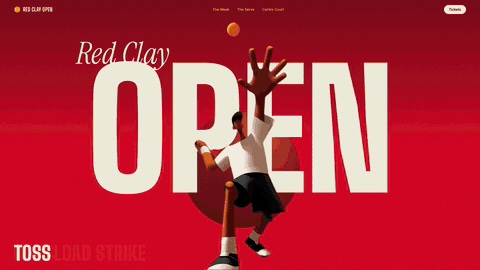
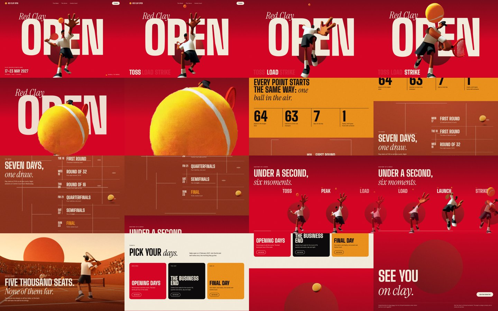

# Red Clay Open

A scroll landing page concept for a clay-court tennis tournament, built around a single 3D
illustration.

**Live:** https://moh4696.github.io/red-clay-open/

> Design concept. Red Clay Open is a fictional tournament: the dates, venue and ticket tiers are
> placeholders, and nothing is sold here.



## The idea

The illustration freezes the toss, half a second before the hit. The page plays the rest of that
serve as you scroll. The ball leaves the strings and flies at the camera, the page dives into it,
and the ball then follows you down the page: it bounces through the week's schedule and sets into
the red disc at the bottom like a sun.

## How it works

- **The player is the original art, animated.** The figure was cut out of the illustration, placed
  on a flat magenta backdrop and animated with MiniMax H3 image-to-video (via the Higgsfield API):
  one idle loop with matching first and last frames, one full serve.
- **Keyed to real transparency.** Every frame is keyed against its own backdrop colour (the model
  drifted the magenta toward pink mid-clip), and edge pixels are unmixed so the outline stays clean
  over both the red background and the cream type.
- **Alpha video that works in Safari.** The hero loop is a plain H.264 file with the colour on top
  and the matte below; a small WebGL shader recombines them (`js/alphaVideo.js`).
- **Scroll-scrubbed serve.** 79 keyed WebP frames drawn to a canvas as you scroll, then a CSS dolly
  into the ball as it fills the frame.
- **One real-time 3D object.** The felt tennis ball in the schedule and the footer is three.js,
  with a procedural felt texture and a seam traced on the sphere (`js/ball.js`).
- Plain HTML, CSS and JS, no build step. [Lenis](https://github.com/darkroomengineering/lenis)
  for smooth scrolling.



## Run it locally

```bash
python3 -m http.server 8925
```
then open http://localhost:8925/.

## Credits

- Original illustration by **[Omar Saeed](https://www.linkedin.com/in/omarsaeed2)**, from his
  3D Sports Illustrations series. The artwork and the motion derived from it remain his.
- Motion generated with MiniMax H3 and Grok Imagine through the Higgsfield API.
- three.js and Lenis (MIT). Fonts: Big Shoulders Display, Instrument Serif, Inter Tight
  (Google Fonts, SIL OFL).
